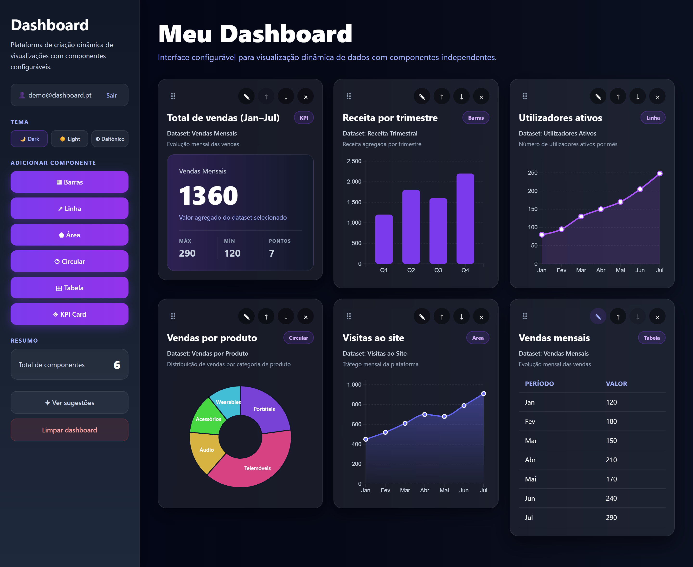
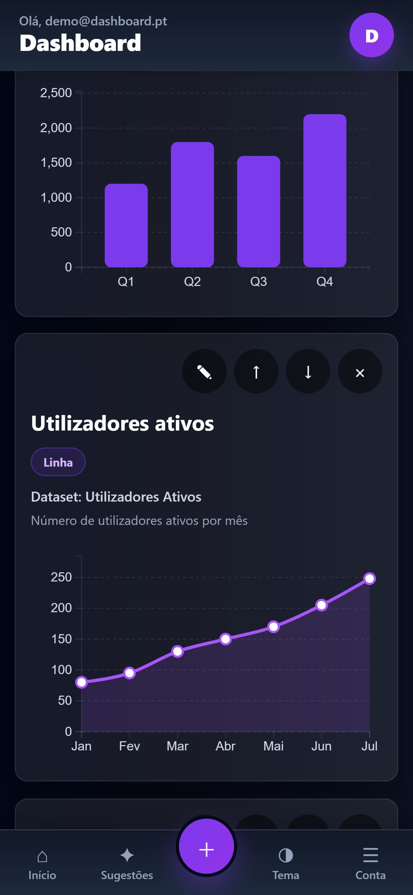

# Dynamic Dashboard Generation Platform 2.0 — Frontend

Plataforma web para a criação de **dashboards dinâmicos e configuráveis**, pensada
para que utilizadores **sem conhecimentos técnicos** consigam montar e adaptar
visualizações de dados de forma simples e intuitiva.

Este repositório é o **frontend** do projeto. O backend (API) é uma componente
separada, desenvolvida por um colega de equipa.

**▶ Demo online:** https://gustavosorocosta.github.io/dashboard-generation-platform-frontend/
— corre em modo demonstração, sem backend. Entre com o botão "Preencher com credenciais demo".



<p align="center">
  
</p>

**Em resumo:** React 19 + D3.js · gráficos desenhados à medida · arrastar-e-largar
com alternativa por teclado · temas Escuro, Claro e Daltónico · layout móvel e
Android (Capacitor) · integração REST com autenticação JWT · acessibilidade WCAG.

---

## 1. Identificação

| | |
|---|---|
| **Trabalho** | Dynamic Dashboard Generation Platform 2.0 – Frontend |
| **Aluno** | Gustavo Soro Costa (nº 82674) |
| **Curso** | Licenciatura em Engenharia Informática |
| **Unidade curricular** | Laboratório de Projeto em Engenharia Informática |
| **Orientador** | Fernando Cassola (INESC TEC) |
| **Coorientadores** | Marco Oliveira; André Thiago Neto; Hugo Alexandre Paredes Guedes da Silva |
| **Centro de investigação** | INESC TEC — HUMANISE |
| **Área** | Desenvolvimento Web |

---

## 2. Objetivos do projeto

- Desenvolver uma interface web **intuitiva e interativa** para criar dashboards dinâmicos.
- Permitir a **personalização de visualizações** por utilizadores não técnicos.
- Garantir a **integração com o backend através de APIs**, com fluxo de dados eficiente.
- Assegurar **desempenho, responsividade e escalabilidade**.
- Cumprir as normas de **acessibilidade web (WCAG)**.
- Produzir **documentação** técnica e de apoio à utilização.

---

## 3. Funcionalidades implementadas

**Componentes de visualização** (configuráveis: título, fonte de dados, cor, tooltip)
- Gráfico de **barras**, de **linha**, de **área** e **circular** (D3.js)
- **Tabela** de dados e **KPI Card** (valor agregado, máximo, mínimo, nº de pontos)

**Construção do dashboard**
- Adicionar componentes (barra lateral no desktop; botão flutuante + painel no telemóvel)
- **Arrastar-e-largar** para reordenar (com alternativa por teclado: setas ↑↓)
- Remover componentes e **limpar** o dashboard (com confirmação)
- **Sugestões** de componentes com base no que já existe
- **Persistência automática** da disposição

**Interface e experiência**
- **Dois layouts**: chrome móvel nativa (barra inferior + botão flutuante + *bottom sheets*) e barra lateral em desktop — muda automaticamente aos 768px
- **Temas** Escuro, Claro e Daltónico
- **Animações** de entrada (cards e gráficos) e **notificações** (toasts) de feedback
- Estados de **carregamento** e de **erro** tratados

**Acessibilidade (WCAG)**
- `aria-label`/`role` nos controlos, foco visível por teclado, *skip link*
- Anúncios para leitores de ecrã (`aria-live`) nas ações
- Respeito por `prefers-reduced-motion`; idioma da página definido (`pt-PT`)

**Dados em tempo real (integração com o backend)**
- Registo e início de sessão reais (token **JWT**)
- Listagem das **fontes de dados** do backend
- Pedido da **análise** de cada fonte (processada com Pandas) e transformação para os gráficos
- Funciona também em **modo demonstração** (mock) sem backend

**Aplicação móvel**
- Empacotamento **Android** via Capacitor

> *Visualização em mapa está prevista como evolução futura (ainda não implementada).*

---

## 4. Tecnologias

- **React 19** + **Vite** (build e dev server)
- **D3.js** (gráficos desenhados à medida)
- **Capacitor** (empacotamento Android)
- **ESLint** (qualidade de código)
- Backend (componente do colega): **FastAPI** + **PostgreSQL** + **Pandas**

---

## 5. Arquitetura

```
src/
  components/   # Componentes de UI (cards, graficos D3, login, barra lateral, shell movel, ...)
  services/     # Camada de dados: toda a comunicacao passa por aqui
  hooks/        # Hooks reutilizaveis (ex.: detecao de viewport)
  context/      # Contexto de tema
  data/         # Datasets de exemplo (usados no modo mock)
  index.css     # Estilos (variaveis de tema, layouts, animacoes)
```

**Camada de serviços** — os componentes importam **apenas** de `services/api.js`.
A mesma interface tem duas implementações intermutáveis:
- `mockApi.js` — dados de exemplo + `localStorage` (funciona sem backend)
- `realApi.js` — chamadas REST ao backend real

A troca é feita por uma variável de ambiente (`VITE_USE_MOCK`), sem alterar nenhum
componente. O contrato completo da API está documentado em **`BACKEND.md`**.

---

## 6. Como executar

```bash
npm install        # instalar dependencias
npm run dev        # arrancar em modo desenvolvimento
```

Por omissão arranca em **modo demonstração** (sem backend). Credenciais demo:
`demo@dashboard.pt` / `demo123` (ou o botão "Preencher com credenciais demo").

Para ligar ao **backend real**: copiar `.env.example` para `.env`, definir
`VITE_USE_MOCK=false` e `VITE_API_URL`, e ter o backend a correr (ver `BACKEND.md`).

Build de produção: `npm run build`. Android: `npm run build:android`.

---

## 7. Relação com o plano de trabalho

O trabalho cobre as tarefas do plano, com destaque para:
- **Tarefa 6** — componentes de dashboards dinâmicos
- **Tarefa 7** — integração com o backend via API
- **Tarefa 8** — otimização de desempenho e **acessibilidade**
- **Tarefa 9** — testes e validação
- **Tarefa 10** — documentação
